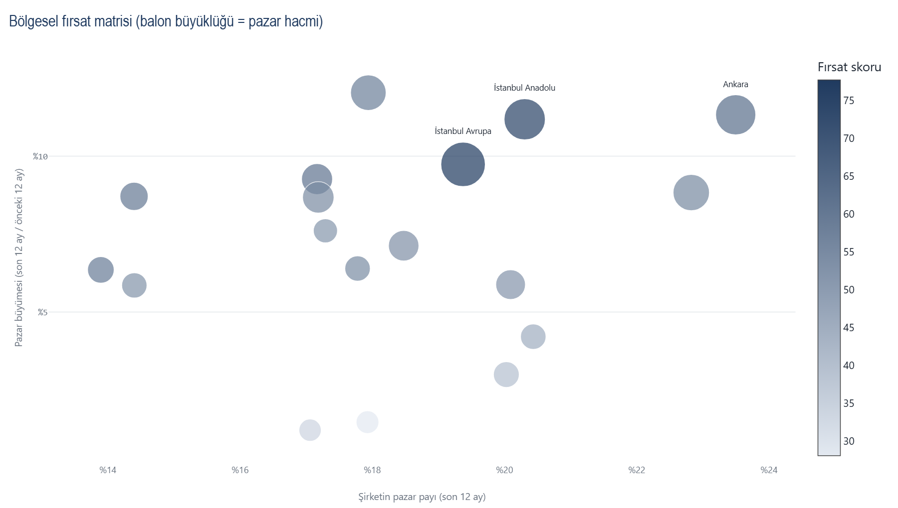
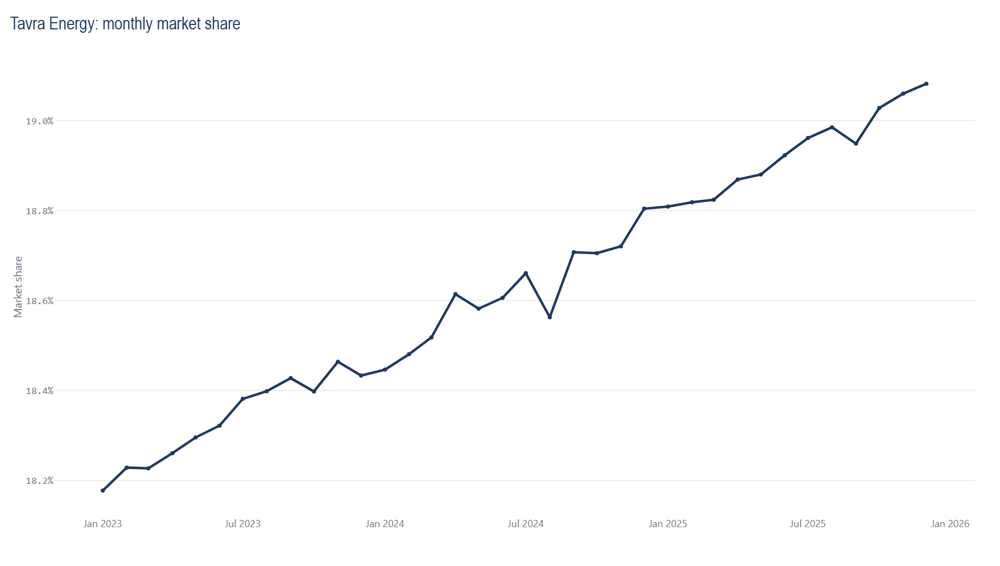
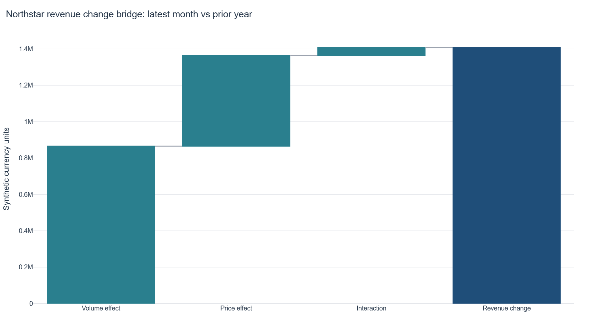

[](https://github.com/mertcanakdogan/energy-market-intelligence-dashboard/actions/workflows/tests.yml)

# Energy Market Intelligence Dashboard

> A production-style portfolio project that turns raw commercial records into SQL-led market, profitability, competitive, and regional decision support.

This repository models a fictional 36-month energy market in which **Northstar Energy** competes across 18 synthetic regions. It is designed for commercial analytics, BI, pricing, revenue, insights, and energy-analysis portfolios; forecasting and machine learning are intentionally outside the core scope.



| Market-share movement | Profitability bridge |
|---|---|
|  |  |

## Business problem

Management needs a repeatable view of market growth, Northstar's share, competitor momentum, regional concentration, and the profitability quality of volume. This project builds that view from a clear star schema and reusable DuckDB SQL models. It highlights signals for analyst investigation; it does not automate business decisions.

## Key capabilities

- Deterministic synthetic data with seasonality, gradual growth, regional heterogeneity, share shifts, cost inflation, margin compression, and structured noise.
- DuckDB star schema and seven ordered SQL models using joins, CTEs, `CASE`, windows, `LAG`, rolling measures, ranks, contribution calculations, HHI, and financial bridges.
- Commercial KPIs covering volume, growth, market share, revenue, gross profit, gross margin, profit/MWh, and regional/product performance.
- Explainable competitor momentum and regional Opportunity Score diagnostics.
- Six-page Streamlit dashboard with management-oriented Plotly visuals.
- Transparent, non-causal scenario arithmetic for user-defined price, volume, and variable-cost assumptions.
- Automated validation, tests, coverage, linting, package build, CI, reproducibility metadata, and confidentiality checks.

## Architecture

```text
config/default.yaml
        │
        ▼
deterministic synthetic generator ──► data/generated/*.csv (ignored)
        │
        ▼
schema and financial validation
        │
        ▼
DuckDB star schema ──► numbered SQL views ──► energy_market.duckdb (ignored)
        │
        ├──► compact CSV/PNG examples + run_metadata.json
        │
        └──► Streamlit decision-support pages
```

The pipeline is the only writer. The dashboard opens the generated database read-only and filters trusted views without interpolating user input into SQL.

## Data model and SQL

The declared fact grain is **one row per month × region × company × product**.

- `dim_date`: month, year, quarter, and display labels.
- `dim_region`: fictional region attributes and public-demo segmentation.
- `dim_company`: Northstar Energy plus six fictional competitors.
- `dim_product`: four generic product segments.
- `fact_sales`: volume, average price, revenue, variable cost, gross profit, and gross margin.

The [`sql/`](sql/) layer is intentionally prominent. It builds monthly company share, market growth, rolling 3/6-month performance, YoY comparisons, competitor momentum, regional company ranks, HHI, profitability summaries, a revenue-change bridge, regional opportunity inputs, and executive KPIs.

Market shares are stored as **fractions from 0 to 1**. HHI is calculated as:

```text
HHI = Σ(company fractional market share²)
```

The generic labels in the dashboard use `< 0.15` as fragmented, `0.15–<0.25` as moderately concentrated, and `≥ 0.25` as concentrated. They are analytical context only, not a legal or regulatory assessment.

## Commercial metric definitions

| Metric | Definition |
|---|---|
| Market volume | Sum of all company volume in MWh |
| Northstar market share | Northstar volume ÷ total market volume |
| YoY growth | Current value ÷ value 12 months earlier − 1, or latest 12 months versus prior 12 where labelled |
| Gross profit | Revenue − variable cost |
| Gross margin | Gross profit ÷ revenue |
| Profit/MWh | Gross profit ÷ volume |
| Share change | Current fractional share − prior share, displayed in percentage points |
| HHI | Sum of squared fractional company shares |

### Revenue change bridge

There is no single universal price-volume-mix convention. This project uses a documented, exactly reconciling base-period bridge:

```text
Volume effect      = (V1 − V0) × P0
Price effect       = V0 × (P1 − P0)
Interaction effect = (V1 − V0) × (P1 − P0)
Revenue change     = Volume effect + Price effect + Interaction effect
```

The interaction term captures simultaneous price and volume movement. The bridge is descriptive and does not infer causality.

## Opportunity Score methodology

Each region is min-max transformed to a 0–100 scale on six components. Constant components receive a neutral score of 50. The public-demo weights live in [`config/default.yaml`](config/default.yaml):

| Component | Direction | Weight |
|---|---:|---:|
| Market size | Higher is more attractive | 20% |
| Market growth | Higher is more attractive | 20% |
| Northstar share gap | Larger gap is more attractive | 20% |
| Recent share momentum | Higher is more attractive | 15% |
| Gross-margin attractiveness | Higher is more attractive | 15% |
| Competitive intensity | Lower HHI is more attractive | 10% |

> **Opportunity Score:** This is a transparent analytical prioritisation heuristic for demonstration purposes, not a causal model or automated decision rule.

The page exposes every component, so an analyst can see why a region ranks where it does. The weights and thresholds are newly chosen for this public demo and are not presented as optimal.

## Scenario analysis disclaimer

The scenario page applies user-selected changes to baseline unit price, volume, and unit variable cost, then recalculates revenue, gross profit, margin, and deltas. **This simulator evaluates arithmetic consequences of assumptions; it is not a causal demand model.** Volume response is explicitly labelled as a user-defined scenario assumption.

## Synthetic demonstration results

The following values are populated from the finished deterministic pipeline, not invented manually:

- History: **36 months**
- Regions / companies / products: **18 / 7 / 4**
- Fact rows: **18,144**
- Latest 12-month Northstar market share: **18.03%**
- Latest 12-month market growth: **7.84%**
- Highest Opportunity Score region: **Sunrise Coast** at **82.88 / 100**
- Average regional HHI: **0.1545** using fractional shares
- Latest 12-month gross margin and YoY change: **23.06%, up 1.34 pp**

All performance numbers above come exclusively from the synthetic demonstration dataset and do not describe a real company or market.

## Repository structure

```text
config/                 Public-demo parameters and opportunity weights
data/sample/            Data-generation notes; full generated data is ignored
sql/                    Ordered DuckDB schema and analytical SQL models
src/energy_market_intelligence/
                        Generator, validation, database, analytics, pipeline, charts
pages/                  Six Streamlit decision-support pages
tests/                  Unit and end-to-end tests
outputs/examples/       Compact CSV results and representative PNG charts
.github/workflows/      Python 3.12 quality checks
```

## Run locally

Python 3.12 is the supported reference version. Chrome or Chromium is also required only for
Kaleido's local PNG export during the pipeline; the interactive dashboard itself has no browser
automation dependency.

```bash
python -m venv .venv
# Windows PowerShell
.venv\Scripts\Activate.ps1
python -m pip install --upgrade pip
python -m pip install -e ".[dev]"
python -m energy_market_intelligence.pipeline
streamlit run app.py
```

The dashboard will open at the local address printed by Streamlit. No API key, external database, paid service, Docker, or network data source is required.

## Testing and quality

```bash
pytest
pytest --cov
ruff check .
python -m build
```

GitHub Actions runs Ruff and pytest with coverage on pushes and pull requests using Python 3.12. The pipeline also writes a SHA-256 dataset fingerprint and run metadata for reproducibility.

## Clean-room and confidentiality statement

**This is an independent portfolio implementation built entirely with synthetic data. It does not contain employer data, employer source code, customer information, proprietary commercial logic, internal pricing, confidential business rules, or private company datasets.**

All source code, SQL, scoring logic, data schemas, assumptions, tests, documentation, charts, and example results were newly created for this repository. Company and region names are fictional. Full raw generated data and the local DuckDB database are deliberately excluded from version control.

## Limitations

- Synthetic patterns demonstrate analytical techniques; they are not calibrated to a real energy market.
- Opportunity weights are an explainable prioritisation aid, not an optimization result.
- HHI labels are generic analytical context and may not match jurisdiction-specific guidance.
- Scenario results are arithmetic sensitivities, not forecasts, elasticities, recommendations, or causal estimates.
- Gross profit includes the synthetic variable-cost fields modeled here and is not a complete financial statement.

## Author

**Mert Can Akdoğan**

Commercial analytics and business intelligence portfolio project.

## License

[MIT](LICENSE)
