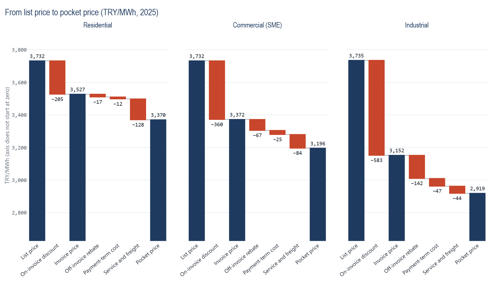
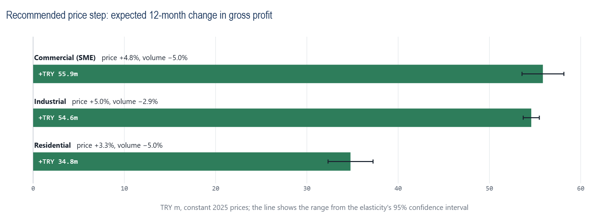
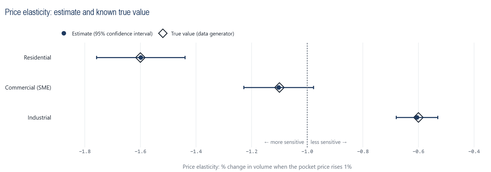
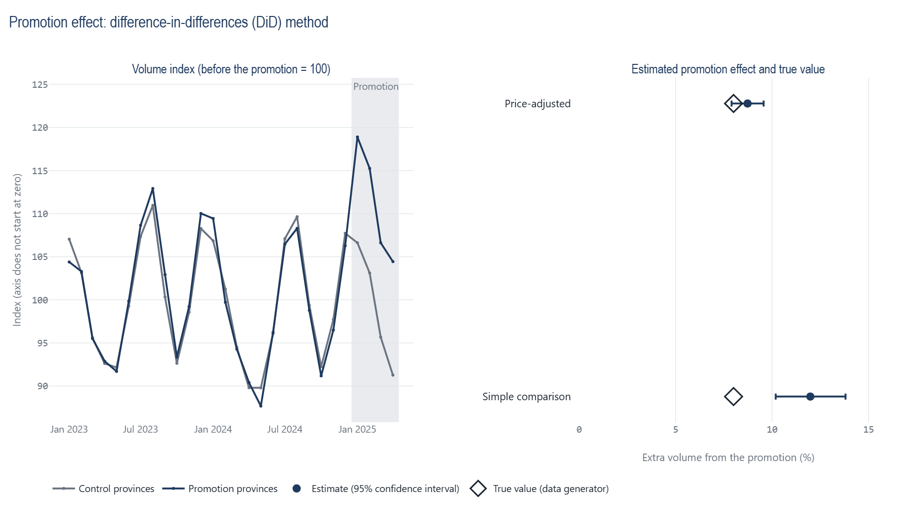

[](https://github.com/mertcanakdogan/energy-market-intelligence-dashboard/actions/workflows/tests.yml)

# Tavra Energy: Pricing and Revenue Analytics

A case study for a **fictional Turkish electricity retailer**. It answers one business question: *where should the company change its prices, and what is that worth?* The data are synthetic, so every result can be checked against the true answer.

**[Open the live app](https://tavra-energy-pricing.streamlit.app)**

All money is in Turkish lira (TRY) at **constant 2025 prices**, so the numbers contain no inflation. The data cover January 2023 to December 2025. "The latest 12 months" means calendar year 2025.

## Key terms

| Term | Plain meaning |
|---|---|
| **List price** | The price on the price list, in TRY per MWh (megawatt-hour of electricity). |
| **Pocket price** | What is left after every discount, rebate, payment-term cost and service cost. This is the price that matters for profit. |
| **Price leakage** | The share of the list price that never reaches the company. |
| **Price realization** | Pocket revenue divided by list revenue: how much of the list price survives. |
| **Price waterfall** | A chart that walks from the list price down to the pocket price, one deduction at a time. |
| **PVM bridge** | Price-volume-mix bridge. It splits a change in revenue or profit into a price effect, a volume effect and a mix effect (and a unit-cost effect for profit). |
| **Elasticity** | How much sales volume changes when the price rises by 1%. An elasticity of -1.6 means a 1% price rise loses about 1.6% of volume. Below -1, customers are price sensitive ("elastic"). |
| **DiD (difference-in-differences)** | Compares provinces that ran a promotion with provinces that did not, to find the extra volume the promotion really created. |
| **95% CI (confidence interval)** | The range that should contain the true value in 95 out of 100 repeated draws. |
| **Gross margin** | Net revenue minus energy cost, divided by net revenue. |

## Executive summary

**Business question:** where should Tavra Energy change prices, and what is it worth?



All figures are for 2025 (compared with 2024 where stated), in constant 2025 TRY. They come from [`outputs/examples/`](outputs/examples/) and `run_metadata.json`.

**Three findings**

1. **14.8% of the list price never reaches the company.** Of TRY 5.50bn list revenue, the company keeps TRY 4.69bn (price realization 85.2%). The gap is widest for Industrial customers: list price 3,735 TRY/MWh, pocket price 2,918 TRY/MWh, a 21.9% gap. It is 9.7% for Residential and 14.4% for Commercial (SME) customers. In four provinces (Izmir, Antalya, Adana and Erzurum; 12 province-segment cases) discounts go beyond the policy limit. That costs TRY 23.4m a year. Industrial customers in the weakest provinces earn a pocket margin of only 7.1% to 10.6%.
2. **Revenue grew, gross profit did not.** Net revenue rose by TRY 186.9m (volume +TRY 130.4m, price +TRY 57.9m, mix −TRY 1.4m). Gross profit fell by TRY 36.3m, because higher unit energy costs took TRY 122.4m. Price increases covered only about 47% of the cost increase.
3. **Each segment reacts to price differently, and the model finds it.** Estimated elasticities: Residential -1.60 (price sensitive), Commercial (SME) -1.10 (borderline; its 95% CI of -1.23 to -0.98 includes -1) and Industrial -0.61 (not very price sensitive). The January-April 2025 discount campaign really added 8% volume. The model estimates 8.7% (95% CI 7.9% to 9.6%) after it adjusts for the price cut. A simple before/after comparison says 12.0%.

**Recommendation:** raise the pocket price a little in every segment: Industrial +5.0%, Commercial (SME) +4.8%, Residential +3.3%. Each step is capped at 5%, and no segment may lose more than 5% of its volume. Also stop the extra discounts in the four provinces above. The model expects gross profit to rise by TRY 145.2m a year (+14.9% on a TRY 973.1m baseline; TRY 139.6m to TRY 150.9m across the elasticity confidence interval). The cost is a 2.9% to 5.0% volume loss. This is a decision aid built on simple assumptions; see [Limitations](#limitations).



## How we know the model works

The data generator uses known true values, so we can test whether the estimates recover them. Elasticities come from a log-log regression per customer segment. The model controls for month of year, province x product, a trend and the competitor price, and its standard errors are clustered by province:

| Segment | True elasticity | Estimate | Std. error | 95% CI | Truth inside CI |
|---|---:|---:|---:|---|:---:|
| Residential | -1.60 | -1.598 | 0.075 | [-1.758, -1.439] | yes |
| Commercial (SME) | -1.10 | -1.103 | 0.059 | [-1.228, -0.977] | yes |
| Industrial | -0.60 | -0.605 | 0.035 | [-0.680, -0.531] | yes |

Promotion uplift by difference-in-differences (5 promotion provinces and 13 control provinces, months 25 to 28, that is January to April 2025):

| Estimator | True uplift | Estimate | 95% CI | Truth inside CI |
|---|---:|---:|---|:---:|
| Simple 2 × 2 DiD | 8.0% | 12.0% | [10.2%, 13.8%] | no (biased: it also counts the campaign price cut and list-price changes) |
| Price-adjusted two-way fixed-effects DiD | 8.0% | 8.7% | [7.9%, 9.6%] | yes |





**Which random stream is used, and why.** The default run uses seed 20260815. It is the seed of the original market generator (version 1.0.0). It was set before any pricing analysis existed, and it has not been changed to make the estimates look better. Later changes (Turkish price levels in version 2.1.0, English names and provinces in version 2.3.0) leave every estimate above unchanged to three decimals.

One draw can still miss: a 95% interval misses the truth about 1 time in 20. So `tests/test_elasticity.py` also re-draws the pricing noise for six other seeds. It requires at least 85% coverage and a mean bias below 0.08. In the current data, 16 of those 18 intervals contain the truth (89%) and the mean bias is at most 0.03.

## The fictional Turkish setting

The company and all figures are invented. The provinces are real places in Turkey, but their sizes, prices and growth are made up.

| Item | Setting |
|---|---|
| Focus company | **Tavra Energy** |
| Six competitors | Veyra Energy, Ormena Energy, Kuvara Energy, Yelkara Energy, Ozvela Energy, Alvora Energy |
| 18 sales provinces | Istanbul, Kocaeli, Tekirdağ, Bursa, Izmir, Muğla, Antalya, Adana, Konya, Ankara, Kayseri, Zonguldak, Samsun, Trabzon, Erzurum, Van, Gaziantep, Diyarbakır (Istanbul, Kocaeli and Ankara are the largest) |
| Customer segments | **Residential** (households), **Commercial (SME)** (shops, offices and small and medium businesses), **Industrial** (industry) |
| Products | Fixed price; Index-linked (PTF+), which follows PTF, Turkey's day-ahead market price for electricity; Green energy (YEK-G), backed by YEK-G, the Turkish renewable energy guarantee certificate; Corporate bundle |
| Currency | TRY per MWh and TRY totals, constant 2025 prices (no inflation modelled) |
| Price level | List prices about 3,280 to 4,200 TRY/MWh, unit energy cost about 2,160 to 2,810 TRY/MWh. Gross margin is 20.7% overall, 15% to 24% by segment and 7% to 28% for single province-segment cases |
| Calendar | 36 months, January 2023 to December 2025. Demand peaks in summer (cooling) and winter (heating) |

The invented first words of the company names (Tavra, Veyra, Ormena, Kuvara, Yelkara, Ozvela, Alvora) were checked with web searches, each together with the Turkish word for energy. None matched a real Turkish energy company. The full names with the English word "Energy" were not searched again. This was a screening, not a trademark search. `tests/test_repo_hygiene.py` also blocks a list of real energy, distribution and fuel brands from entering the repository.

Names in the data: companies, provinces, segments, products and codes are all in English, except that province names keep their Turkish spelling. Inside the tables and SQL a province is still called a region (`dim_region`, `region_id`, `region_name`). `localization.py` formats the numbers and turns column names and codes into readable labels.

## The app

The [live app](https://tavra-energy-pricing.streamlit.app) has six pages, all about pricing. Each page title is the question the page answers. Each page has a short "What this page shows" line and a "What it means" takeaway computed from the data.

| Page | Question it answers | What you see |
|---|---|---|
| **Overview** (home) | Start here: the main finding at a glance | One headline sentence computed from the data, the price breakdown read like the line items of a bill next to the matching waterfall chart, three short answers, and how well the model recovers the known true values |
| **Price leakage** | Where does price leak? | The price waterfall by segment and the provinces that discount beyond policy |
| **Revenue bridge** | Why did revenue change? | The price-volume-mix bridge for net revenue and gross profit |
| **Price sensitivity** | How sensitive are customers to price? | Estimated elasticity per segment next to the true value |
| **Promotion impact** | Did the promotion really work? | The simple and the price-adjusted DiD estimates of the campaign uplift |
| **Price recommendation** | Which price step is worth taking? | The capped price step per segment and the expected change in gross profit |

Colours, fonts and design rules are described in [DESIGN.md](DESIGN.md); who the app is for and what it must do are in [PRODUCT.md](PRODUCT.md).

## Also in the repository

The project started as a market-intelligence dashboard. Its market-share, competitor, profitability, regional-opportunity and scenario analytics are still in the code base, with their SQL views (`sql/02` to `sql/07`) and pipeline outputs in `outputs/examples/`. They are not shown in the app.

## Business questions answered

- Where does list price leak on the way to pocket price, and which provinces discount beyond policy? (`vw_price_waterfall`, `vw_discount_policy_flags`)
- Why did revenue and gross profit move: price, volume, mix or cost? (`vw_pvm_bridge`)
- How price sensitive is each customer segment? (`elasticity.py`)
- Did the discount campaign create extra volume? (`promotion.py`)
- Which price step is worth taking, within margin and volume limits? (`price_recommendation.py`)

## Run it

Python 3.14 is the main version (CI, Streamlit Cloud and the devcontainer); CI also tests 3.12. Python 3.15 runs in CI as an informational job until DuckDB ships Python 3.15 wheels. Chrome or Chromium is only needed by Kaleido for PNG export in the pipeline.

```bash
python -m venv .venv
# Windows PowerShell: .venv\Scripts\Activate.ps1   |   macOS/Linux: source .venv/bin/activate
python -m pip install --upgrade pip
python -m pip install -e ".[dev]"
python -m energy_market_intelligence.pipeline   # data, SQL models, analyses, outputs/examples, powerbi/data
streamlit run app.py
pytest --cov                                    # tests (coverage floor 85%)
ruff check .
```

If `data/energy_market.duckdb` does not exist, the app builds it on first start (see [DEPLOY.md](DEPLOY.md)).

## Technical detail

### Data model

Two synthetic fact tables share the date, region (province) and product dimensions. In all tables and SQL the province keeps the internal name "region" (`region_id`, `region_name`).

| Table | Grain | Purpose |
|---|---|---|
| `fact_sales` | month x region x company x product | Market view: volume, price, revenue and cost for the focus company and six competitors |
| **`fact_pricing`** | **month x region x product x customer segment** | Pricing ledger of the focus company: list price, discount, rebate, payment-term and freight cost, pocket price, unit cost, competitor price, promotion flag |
| `dim_customer_segment` | segment | Residential, Commercial (SME), Industrial |
| `dim_discount_policy` | segment | Policy maximum for the on-invoice discount |
| `dim_date`, `dim_region`, `dim_company`, `dim_product` | | Shared dimensions (`dim_region` holds the 18 provinces) |

`fact_pricing` has 7,776 rows (36 months x 18 provinces x 4 products x 3 segments). Its volume scale is set to match the market fact, but it is a separate ledger and not an exact split of `fact_sales` (the two differ by about 8% in 2025 revenue).

The true values built into the pricing generator (all in `config/default.yaml`, `pricing:` section):

- **Waterfall:** list price, minus on-invoice discount, equals invoice price. Minus off-invoice rebate, payment-term cost and service/logistics cost, equals pocket price. Discounts grow from Residential to Industrial, and four leakage provinces discount beyond policy.
- **Price variation used for estimation:** list-price increases at different times in different provinces (months 7, 14, 21 and 28: July 2023, February 2024, September 2024, April 2025), plus small random monthly discount noise. One province never changes its list price.
- **Demand:** `log(volume) = province-product-segment intercept + seasonality + trend + elasticity x log(pocket price) + 0.35 x log(competitor price) + log(1.08) x promo + noise`, with true elasticities -1.6, -1.1 and -0.6.
- **Promotion:** 5 provinces get an extra 3% on-invoice discount and a non-price volume uplift of +8% for four months (January to April 2025). The other 13 provinces are controls.

### SQL layer

Numbered files in [`sql/`](sql/) run in order against the registered data frames. Files 02 to 07 feed the analytics that are kept in the repository but not shown in the app.

| File | Content |
|---|---|
| `01_schema.sql` | Star-schema tables and indexes (market and pricing facts) |
| `02_market_metrics.sql` | Company monthly share, market volume, rolling 3/6-month averages, year-on-year and month-on-month change |
| `03_growth_analysis.sql` | National growth and share trend |
| `04_competitor_intelligence.sql` | Competitor momentum, ranks per province, HHI concentration |
| `05_profitability.sql` | Profitability summaries and the revenue bridge |
| `06_regional_opportunity.sql` | Inputs for the opportunity score per province |
| `07_executive_kpis.sql` | Executive KPI view |
| `08_price_waterfall.sql` | Pricing detail, list-to-pocket waterfall, leakage, policy flags and ranking |
| `09_pvm_bridge.sql` | Price-volume-mix bridge for net revenue and gross profit |

### Methods and assumptions

**Price waterfall.** Per-MWh values are weighted by volume (`SUM(amount) / SUM(volume)`). Leakage = (list - pocket) / list. A province-segment case breaks policy when its on-invoice discount depth (weighted by list revenue) is above the segment maximum. Revenue above policy = excess depth x list revenue.

**PVM bridge.** 2025 against 2024 at product × segment level, on net (pocket) revenue and on gross profit. With total volumes VT0/VT1, cell shares s and cell net prices P0/P1:

```text
Volume effect = (VT1 - VT0) x s0 x P0
Mix effect    = VT1 x (s1 - s0) x P0
Price effect  = V1 x (P1 - P0)
```

These add up exactly to the revenue change (view column `reconciliation_gap`, checked to be about 0 in tests). Gross profit uses the unit margin for volume and mix and adds a unit-cost effect of `-V1 x (C1 - C0)`. If a cell is missing in one period, it takes its price from the other period, so the sum still holds.

**Elasticity.** Log-log OLS (ordinary least squares regression) per segment: `log(volume) ~ log(pocket price) + log(competitor price) + trend + month-of-year + province x product fixed effects + promo`, with standard errors clustered by province and t-based 95% intervals. The slope is identified by price changes that have nothing to do with demand (the planned list-price increases and the discount noise). The province and product fixed effects absorb lasting differences, such as the leakage provinces.

**Promotion DiD.** Treated = provinces that ever carry the campaign flag; before = months before the campaign, after = campaign months. The adjusted model has province × product × segment and month fixed effects, a pocket-price slope per segment and the competitor price. Key assumption: without the campaign, treated and control provinces would have moved in parallel once price is controlled for.

**Price recommendation** (`price_recommendation.py`). Per segment (optionally per province), using the estimated elasticity `e`, the current pocket price and the unit cost `c`:

1. Elastic (`e < -1`): aim for the profit-maximising pocket price `c x e / (1 + e)`. Inelastic: aim for the largest allowed step.
2. Limit every move to the step cap (+/-5%).
3. Limit increases to the price at which the expected volume loss reaches the guard (5%).
4. Apply a pocket-margin floor (15%) last. If the floor cannot be reached within the step cap, apply the full step and flag the group.

Expected volume change is `(1 + price change)^e - 1`. The gross-profit range uses the elasticity confidence limits. In this data the profit-maximising price for the elastic segments is far outside the observed price range, so the step cap and the volume guard decide the result. Four Industrial cases (Erzurum, Adana, Izmir, Diyarbakır) cannot reach the 15% floor in one step.

### Power BI

[`powerbi/measures.md`](powerbi/measures.md) documents the data model (relationships) and DAX measures: Pocket Price, Price Realization %, Discount Leakage, Discount Above Policy, Gross Margin %, year-on-year, rolling 12 months and the PVM components with a reconciliation check. The pipeline exports the star schema (`fact_pricing` and its dimensions) to `powerbi/data/*.csv` (git-ignored). No `.pbix` file is included.

### Project structure

```text
config/default.yaml              Run settings, opportunity weights and the pricing true values
sql/                             Numbered DuckDB models 01-09
src/energy_market_intelligence/
    synthetic_data.py            Market star-schema generator (fictional names, TRY prices)
    pricing_config.py            Typed pricing configuration and true values
    pricing_data.py              Pricing generator (waterfall, demand, promotion)
    validation.py                Data checks that fail loudly, including the waterfall identity
    database.py                  DuckDB build and read-only queries
    elasticity.py                Elasticity estimation per segment
    promotion.py                 Difference-in-differences promotion uplift
    price_recommendation.py      Capped price steps with a margin floor
    scenario.py                  What-if arithmetic (not shown in the app)
    competition.py, profitability.py, opportunity.py, metrics.py
                                 Market, competitor, profitability and opportunity analytics
                                 (not shown in the app)
    localization.py              English number formats, labels and display order
    insights.py                  Takeaway sentences computed from the data for the app pages
    visualization.py, pricing_visualization.py   Plotly figures
    powerbi_export.py            Star-schema CSV export
    pipeline.py                  End-to-end build and example outputs
app.py, dashboard_support.py     Streamlit app: navigation and shared helpers
views/                           The six pages: home.py, price_waterfall.py, pvm_bridge.py,
                                 elasticity.py, promotion_impact.py, price_recommendation.py
dashboard_style.py, .streamlit/  App stylesheet, bill block and theme (see DESIGN.md)
powerbi/measures.md              Power BI model and DAX
tests/                           Unit, SQL, pipeline, page-smoke and repository-hygiene tests
outputs/examples/                Compact CSV and PNG results plus run_metadata.json
DEPLOY.md, requirements.txt      Streamlit Community Cloud deployment
```

## Limitations

- All data are synthetic. The results show the method and that it recovers known values. They are not calibrated to any real market, tariff or regulation (including regulated Turkish tariffs and market prices).
- Amounts are in constant 2025 TRY. Real Turkish prices move with inflation and exchange rates; none of that is modelled.
- Elasticity is constant by design, in line with the model that is estimated. Real demand rarely keeps a constant elasticity over large price moves, so the recommendations are limited to small steps.
- Competitors do not react to the company's price changes, and unit costs are held fixed in the recommendation.
- Elasticities are estimated per customer segment and applied unchanged to every province and product.
- The pricing ledger is a separate sub-ledger; it is not reconciled to `fact_sales`.
- The generator chose the promotion provinces; they were not picked at random. Parallel trends is an assumption that must be checked on real data.
- Recommendations are a decision aid, not an automatic pricing rule. They ignore contract terms, competitor positioning and regulation.
- The Power BI DAX measures are documented but were not run in Power BI Desktop for this repository.

## Confidentiality

This is an independent portfolio project built entirely with synthetic data. It contains no employer data, customer data, proprietary pricing logic or internal business rules. The company names are fictional; the provinces are real places, but all their figures are invented. `tests/test_repo_hygiene.py` scans all tracked text files for real energy-company names, e-mail addresses, local paths, cloud-sync paths and secret-like strings. Generated raw data and the DuckDB file are git-ignored.

## Author

**Mert Can Akdoğan**

## License

[MIT](LICENSE)
